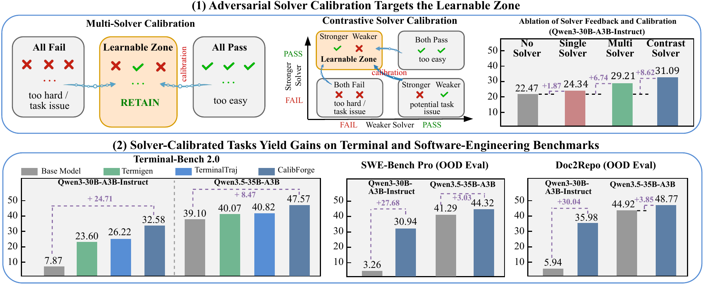

# CalibForge: Adversarial Solver Calibration for Scaling Learnable Terminal Tasks

<p align="center">
  <a href="https://huggingface.co/datasets/AweAI-Team/CalibForge">🤗 Data</a>
  &nbsp;·&nbsp;
  <a href="#-models">🤗 Models</a>
  &nbsp;·&nbsp;
  <a href="https://github.com/AweAI-Team/AweAgent/tree/main/recipes/terminal_bench_v2">🤖 CalibForge-Eval</a>
</p>

## 🔥 Highlights

- **5,431 calibrated terminal tasks** spanning 16 domains and 3,885 distinct capability tags.
- **Adversarial solver calibration** revises tasks toward a solver-relative learnable zone instead of retaining every task that is merely executable.
- **Two complementary calibration strategies:** multi-solver calibration targets disagreement across heterogeneous solvers, while contrastive calibration targets a designated strong-pass/weak-fail relation.
- **Strong and transferable performance:** CalibForge-30B-A3B and CalibForge-35B-A3B reach **32.58%** and **47.57%** on Terminal-Bench 2.0, with gains extending to SWE-bench Pro and Doc2Repo.

## Overview

Training terminal agents requires tasks that are executable and verifiable, but validity alone does not reveal whether a task is appropriately challenging for learning. CalibForge turns task construction into a constrained adversarial author-solver loop: solver agents attempt each candidate, verified outcomes determine whether the task lies in a target capability interval, and full trajectories guide revisions to the instruction, environment, and verifier.

<p align="center">
  
</p>

CalibForge supports two calibration strategies:

- **Multi-solver calibration** retains a task when at least one solver succeeds and at least one solver fails.
- **Contrastive solver calibration** retains a task when a designated stronger solver succeeds and a designated weaker solver fails.

Both criteria anchor task difficulty in demonstrated solvability while avoiding candidates that are uniformly solved under the selected solver setting.

## 📦 Released Data

The full release is hosted on [Hugging Face](https://huggingface.co/datasets/AweAI-Team/CalibForge) and contains:

| Split | Tasks | Calibration criterion |
|---|---:|---|
| Multi-solver | 1,263 | At least one solver passes and at least one solver fails |
| Contrastive | 4,168 | Stronger solver passes and weaker solver fails |
| **Total** | **5,431** | Solver-relative learnable zone |

The release also includes successful trajectories distilled under the shared [CalibForge-Eval](https://github.com/AweAI-Team/AweAgent/tree/main/recipes/terminal_bench_v2) protocol.

## 📂 Task Format

CalibForge tasks use the Harbor task format. Each task is packaged as a self-contained terminal environment:

```text
task_id/
├── instruction.md
├── task.toml
├── environment/
│   ├── Dockerfile
│   └── files/
└── tests/
    ├── test.sh
    └── test_outputs.py
```

| Component | Description |
|---|---|
| `instruction.md` | Natural-language task specification presented to the agent |
| `task.toml` | Task metadata and runtime configuration |
| `environment/` | Docker definition and initial artifacts |
| `tests/` | Executable verifier used to determine task success |

## 🚀 Download

Using the Hugging Face CLI:

```bash
hf download AweAI-Team/CalibForge \
  --repo-type dataset \
  --local-dir CalibForge-data
```

Refer to the dataset card for the released files and loading instructions.

## 🤗 Models

We release two models trained on trajectories distilled from CalibForge tasks:

| Model | Backbone | Terminal-Bench 2.0 |
|---|---|---:|
| [CalibForge-30B-A3B](https://huggingface.co/AweAI-Team/CalibForge-30B-A3B) | Qwen3-30B-A3B-Instruct | 32.58% |
| [CalibForge-35B-A3B](https://huggingface.co/AweAI-Team/CalibForge-35B-A3B) | Qwen3.5-35B-A3B | 47.57% |

## 🤖 CalibForge-Eval

CalibForge-Eval is released as the [Terminal-Bench 2.0 recipe in AweAgent](https://github.com/AweAI-Team/AweAgent/tree/main/recipes/terminal_bench_v2). It provides the minimal bash, file-editing, and finish-tool scaffold used for trajectory distillation and Terminal-Bench 2.0 evaluation.

After installing and configuring AweAgent, run it on a Harbor-style task directory with:

```bash
python recipes/terminal_bench_v2/run.py \
  --task-data-dir /path/to/tasks \
  --data-file /path/to/instance_ids.json
```

See the recipe documentation for model configuration, concurrent execution, and output formats.

## 🤖 Results

Training on CalibForge trajectories consistently improves both backbones across terminal and out-of-distribution software-engineering benchmarks.

| Model | TB2 Acc. (%) ↑ | SWE-Pro Resolved (%) ↑ | Doc2Repo Pass Rate (%) ↑ |
|---|---:|---:|---:|
| Qwen3-30B-A3B-Instruct → **CalibForge-30B-A3B** | 7.87 ± 0.00 → **32.58 ± 1.12** (**+24.71**) | 3.26 → **30.94** (**+27.68**) | 5.94 ± 0.88 → **35.98 ± 1.82** (**+30.04**) |
| Qwen3.5-35B-A3B → **CalibForge-35B-A3B** | 39.10 ± 1.09 → **47.57 ± 0.99** (**+8.47**) | 41.29 → **44.32** (**+3.03**) | 44.92 ± 1.14 → **48.77 ± 0.90** (**+3.85**) |

Terminal-Bench 2.0 and Doc2Repo results are reported as mean ± SEM over three runs; SWE-bench Pro is evaluated once.

### Effect of Solver Calibration

Under a matched 1,300-task setting, adversarial solver calibration provides substantially larger gains than ordinary single-solver feedback.

| Construction mode | SFT trajectories | TB2 Acc. (%) ↑ | Δ vs. no solver |
|---|---:|---:|---:|
| No solver | 2,466 | 22.47 | – |
| Single solver | 2,493 | 24.34 | +1.87 |
| Multi-solver calibration | 2,425 | 29.21 | +6.74 |
| Contrastive solver calibration | 2,561 | **31.09** | **+8.62** |

## 🎗️ Supporters

This project is mainly developed and maintained by students from [RUC AI Box](https://github.com/RUCAIBox).